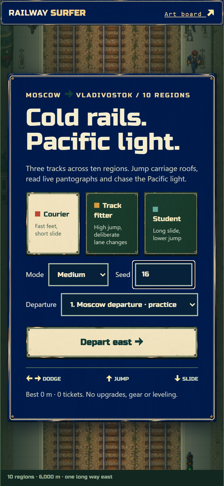
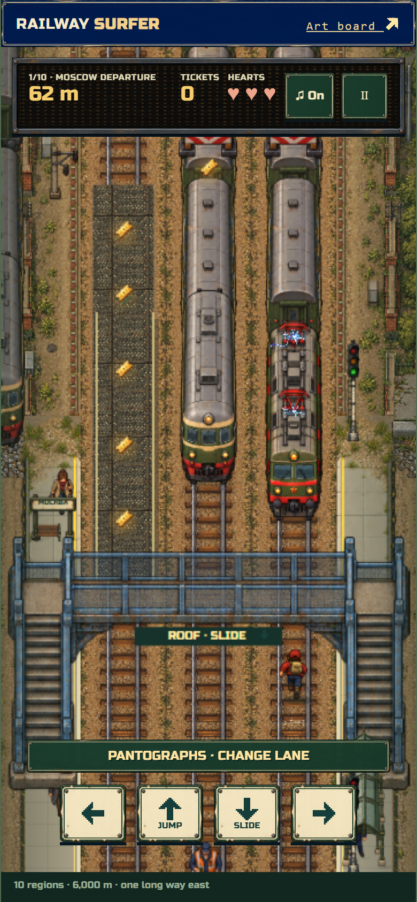
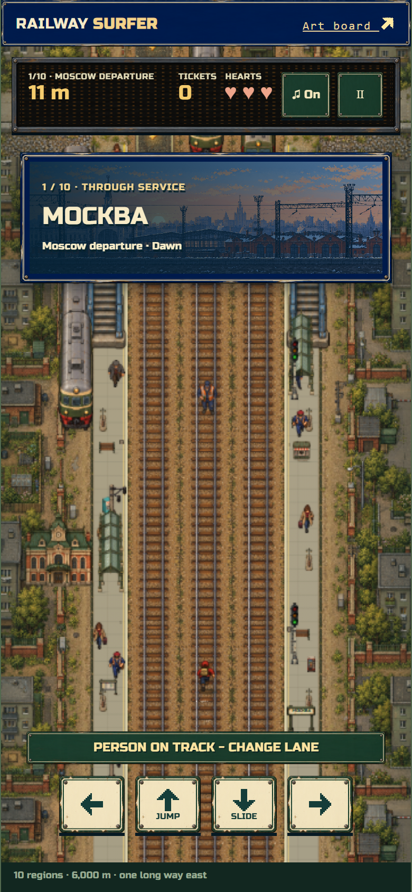
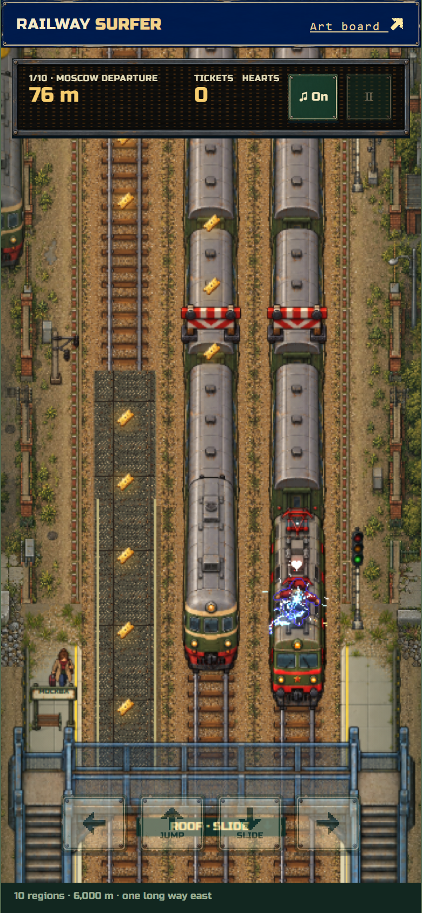
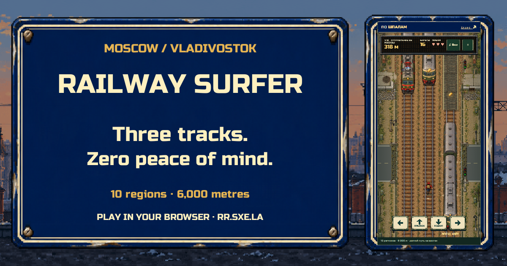

# Illustrated example: an English railway runner

These images come from our authored Railway Surfer project, included at the
user's request. Open the frame relevant to the current task. They illustrate
specific decisions; the railway theme, three-role menu, portrait projection and
numeric tuning are not universal requirements or a template for other sources.
No runtime game data, extracted assets, audio or playable build is bundled.

## Native-style UI with readable English text

**Observe:** the title, panel border, character cards and primary action share
the railway-sign material language. Live English labels occupy quiet interior
areas rather than being baked into the frame. The desktop can retain this narrow
mobile composition. Keep the target game's identity instead of copying this theme.
The example explicitly omits gear/leveling, illustrating a user-selected scope
override of module progression defaults.

**Apply:** [native UI](../nostalgic-ui-workflow.md),
[localization](../localization.md), [mobile layouts](../platform-and-mobile.md).
Verify your own longest translations, glyphs and actual touch actions; a still
image alone does not establish those behaviors.

## Parallel lanes and readable vertical clearance

**Observe:** an orthographic top-down angle exposes all three lanes; train roofs
retain their proportions and readable support surfaces. The overhead bridge is
visually distinct from roofs and ground. Tickets and the pantograph warning use
different silhouettes and colors. The control arrows are sprites within panels.

**Apply:** [runner geometry and collision](../genres/runner/implementation.md),
[track fairness](../genres/runner/track-generation-and-fairness.md).
Define actual roof support, side/head-on contact and bridge clearance in the
simulation. This frame illustrates visibility; it cannot prove reachability,
correct collisions or a safe reaction window by itself.

## City arrival and wider scenery composition

**Observe:** the scene opens out to show coherent side scenery, with an illustrated
city card using the same blue frame as the interface. The English interface
retains the native Cyrillic city name as intentional local identity; that is a
project translation choice, not evidence of complete localization in every asset.

**Apply:** [presentation contracts](../implementation-and-validation.md),
[asset loading and transitions](../asset-delivery.md),
[runner workflow](../genres/runner/workflow.md). Preload the next scene and inspect
moving transitions separately. This opening splash is not evidence that every
later transition is hazard-free or that preload budgets pass.

## Electricity bound to the actual actor and cause of death

**Observe:** blue-white electrical feedback wraps the game's own runner at the
locomotive contact point. The player can see the cause before reading a results
menu. Effects continue during the death presentation rather than disappearing
when ordinary movement stops.

**Apply:** [PixelFX integration](../tools-and-skills.md#pixelfx-integration).
Use the actual actor mask and attachment geometry, real damage/death events,
bounded effect instances and the correct presentation clock. The collision here
was staged intentionally through keyboard input. A screenshot cannot demonstrate
the full flash/hop/fall timing; review an actual motion sequence for that claim.

## English link preview in the same art direction

**Observe:** large English title/copy, padding and a gameplay inset remain legible
in the landscape sharing format. This is composed preview artwork, not a full
gameplay screenshot or generated substitute for game evidence.

**Apply:** [localized share previews](../social-link-previews.md). Keep the preview
language aligned with initial HTML metadata and the chosen locale. Inspect the
thumbnail as well as the full-size card; the image does not prove crawler access
or cache invalidation on a deployed site.

## Provenance and tested scope

The four game screenshots were captured from the English 0.9.5 build in isolated
Chromium at 390 x 844 CSS pixels, DPR 2, with seed 16 and a virtual frame clock.
The electrical collision was intentional; no simulation-state injection was used.
They establish the displayed composition, not physical-phone performance,
human balance or certification of every system. The social card is an existing
English composed project asset and can show a different gameplay moment.

Images retain their source dimensions and RGB pixels through lossless WebP,
without repainting, synthetic captions or stretching. The
[image manifest](../../assets/examples/railway-runner/manifest.json) records hashes,
dimensions, capture state and scope. This curated example permission does not
authorize copying arbitrary third-party game data into the toolkit.
